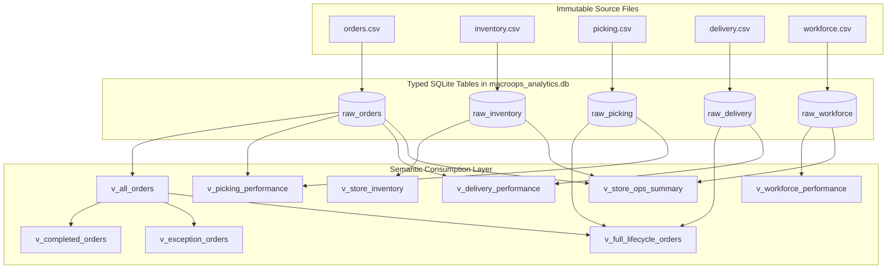

# MacroOps AI — Canonical Analytical Data Layer Architecture

**Platform:** MacroOps AI — Fulfillment & Operations Intelligence Platform  
**Document Version:** 1.0  
**Phase:** Analytical Modeling & Semantic Layer  
**Engine:** SQLite 3.50.4 (Local Embedded Database Engine)  
**Database File:** [`macroops_analytics.db`](file:///c:/Users/HP/Desktop/MacroOps/macroops_analytics.db)  
**Builder Script:** [`build_analytical_layer.py`](file:///C:/Users/HP/.gemini/antigravity-ide/brain/09a7719e-6e76-418c-85b6-9a58a0a6fae9/scratch/build_analytical_layer.py)  
**Date:** September 28, 2026  

---

## 1. Architectural Strategy & Design Principles

To support rapid prototyping, interactive dashboards, RAG assistant retrieval, and ML feature stores **without modifying the source CSV files**, we created an embedded canonical analytical database using SQLite:

1. **Non-Destructive Ingestion:** The 5 original CSV files were imported into 5 typed base tables (`raw_orders`, `raw_inventory`, `raw_picking`, `raw_delivery`, `raw_workforce`).
2. **Indexed Performance:** Secondary indexes were established on primary query dimensions (`store_id`, `order_time`, `status`, `picker_id`, `rider_id`, `sku_id`, `role`, `shift`) enabling sub-50ms analytical queries across all 200,000 records.
3. **Semantic Views Layer:** 9 logical views decouple raw synthetic storage from business consumption, standardizing dates, isolating operational cohorts, reconciling milestones, and computing clean business metrics.



---

## 2. Base Table Specifications

### 2.1. `raw_orders` (100,000 Rows)
```sql
CREATE TABLE raw_orders (
    order_id TEXT PRIMARY KEY,
    store_id TEXT NOT NULL,
    order_time TEXT NOT NULL,
    item_count INTEGER NOT NULL,
    order_value REAL NOT NULL,
    promised_time TEXT NOT NULL,
    actual_delivery_time TEXT NOT NULL,
    status TEXT NOT NULL,
    sla_breached INTEGER NOT NULL,
    delivery_delay_minutes REAL NOT NULL
);
CREATE INDEX idx_orders_store ON raw_orders (store_id);
CREATE INDEX idx_orders_status ON raw_orders (status);
CREATE INDEX idx_orders_time ON raw_orders (order_time);
```

### 2.2. `raw_inventory` (40,000 Rows)
```sql
CREATE TABLE raw_inventory (
    store_id TEXT NOT NULL,
    sku_id TEXT NOT NULL,
    system_stock INTEGER NOT NULL,
    physical_stock INTEGER NOT NULL,
    stockout TEXT NOT NULL,
    stock_variance INTEGER NOT NULL,
    inventory_accuracy_pct REAL NOT NULL,
    PRIMARY KEY (store_id, sku_id)
);
CREATE INDEX idx_inventory_store ON raw_inventory (store_id);
CREATE INDEX idx_inventory_sku ON raw_inventory (sku_id);
```

### 2.3. `raw_picking` (25,000 Rows)
```sql
CREATE TABLE raw_picking (
    order_id TEXT PRIMARY KEY,
    picker_id TEXT NOT NULL,
    pick_start TEXT NOT NULL,
    pick_end TEXT NOT NULL,
    items_picked INTEGER NOT NULL,
    items_missing INTEGER NOT NULL,
    pick_duration_minutes REAL NOT NULL
);
CREATE INDEX idx_picking_picker ON raw_picking (picker_id);
```

### 2.4. `raw_delivery` (25,000 Rows)
```sql
CREATE TABLE raw_delivery (
    order_id TEXT PRIMARY KEY,
    rider_id TEXT NOT NULL,
    assignment_time TEXT NOT NULL,
    pickup_time TEXT NOT NULL,
    delivery_time TEXT NOT NULL,
    distance_km REAL NOT NULL,
    assignment_delay_minutes REAL NOT NULL
);
CREATE INDEX idx_delivery_rider ON raw_delivery (rider_id);
```

### 2.5. `raw_workforce` (10,000 Rows)
```sql
CREATE TABLE raw_workforce (
    log_id INTEGER PRIMARY KEY AUTOINCREMENT,
    employee_id TEXT NOT NULL,
    role TEXT NOT NULL,
    store_id TEXT NOT NULL,
    shift TEXT NOT NULL,
    tasks_completed INTEGER NOT NULL,
    tasks_pending INTEGER NOT NULL
);
CREATE INDEX idx_workforce_store ON raw_workforce (store_id);
CREATE INDEX idx_workforce_role ON raw_workforce (role);
CREATE INDEX idx_workforce_shift ON raw_workforce (shift);
```

---

## 3. Logical Analytical Views (Semantic Layer)

### 3.1. `v_all_orders` — Enterprise Standard Order Dimension
- **Purpose:** Standardizes order timestamps, extracts calendar dimensions (`order_date`, `order_hour`, `day_of_week`), derives elapsed durations, and segments orders into value/basket tiers.
- **Population:** 100,000 rows.
```sql
CREATE VIEW v_all_orders AS
SELECT
    order_id,
    store_id,
    order_time,
    substr(order_time, 1, 10) AS order_date,
    CAST(substr(order_time, 12, 2) AS INTEGER) AS order_hour,
    CASE CAST(strftime('%w', order_time) AS INTEGER)
        WHEN 0 THEN 'Sunday' WHEN 1 THEN 'Monday' WHEN 2 THEN 'Tuesday'
        WHEN 3 THEN 'Wednesday' WHEN 4 THEN 'Thursday' WHEN 5 THEN 'Friday'
        WHEN 6 THEN 'Saturday'
    END AS day_of_week,
    item_count,
    order_value,
    promised_time,
    actual_delivery_time,
    status,
    CASE 
        WHEN status IN ('Delivered_On_Time', 'Delivered_Late') THEN 'Completed'
        WHEN status = 'Cancelled' THEN 'Cancelled'
        WHEN status = 'Failed' THEN 'Failed'
        ELSE 'Other'
    END AS order_outcome,
    sla_breached,
    delivery_delay_minutes,
    ROUND((julianday(promised_time) - julianday(order_time)) * 1440.0, 2) AS promised_duration_minutes,
    ROUND((julianday(actual_delivery_time) - julianday(order_time)) * 1440.0, 2) AS actual_duration_minutes,
    CASE
        WHEN order_value < 250 THEN '< 250'
        WHEN order_value < 500 THEN '250 - 500'
        WHEN order_value < 750 THEN '500 - 750'
        WHEN order_value < 1000 THEN '750 - 1000'
        ELSE '1000+'
    END AS value_tier,
    CASE
        WHEN item_count <= 2 THEN 'Small (1-2)'
        WHEN item_count <= 5 THEN 'Medium (3-5)'
        WHEN item_count <= 8 THEN 'Large (6-8)'
        ELSE 'Bulky (9+)'
    END AS basket_tier
FROM raw_orders;
```

---

### 3.2. `v_completed_orders` — Customer Fulfillment & SLA Ground Truth
- **Purpose:** Filters exclusively for delivered customer orders (`status IN ('Delivered_On_Time', 'Delivered_Late')`). Eliminates synthetic delays on Cancelled/Failed orders, ensuring accurate OTD and SLA metrics.
- **Population:** 97,449 rows.
```sql
CREATE VIEW v_completed_orders AS
SELECT *
FROM v_all_orders
WHERE order_outcome = 'Completed';
```

---

### 3.3. `v_exception_orders` — Exception Management Cohort
- **Purpose:** Captures Cancelled and Failed orders for root-cause analysis, churn modeling, and operational triage in Module 3.
- **Population:** 2,551 rows (1,795 Cancelled, 756 Failed).
```sql
CREATE VIEW v_exception_orders AS
SELECT
    order_id,
    store_id,
    order_time,
    order_date,
    order_hour,
    day_of_week,
    item_count,
    order_value,
    status AS exception_type,
    CASE
        WHEN status = 'Cancelled' THEN 'Customer / Merchant Cancellation'
        WHEN status = 'Failed' THEN 'Delivery Drop-off Failure'
        ELSE 'Unknown Exception'
    END AS exception_category
FROM v_all_orders
WHERE order_outcome IN ('Cancelled', 'Failed');
```

---

### 3.4. `v_full_lifecycle_orders` — 360° Order Milestone Telemetry
- **Purpose:** Combines orders, picking, and delivery data for the 25,000 shared orders. Resolves the sequence inversion anomaly by computing the `effective_dispatch_time` and `effective_transit_minutes`.
- **Population:** 25,000 rows.
```sql
CREATE VIEW v_full_lifecycle_orders AS
SELECT
    o.order_id,
    o.store_id,
    o.order_time,
    o.order_date,
    o.order_hour,
    o.item_count,
    o.order_value,
    o.status,
    o.sla_breached,
    o.delivery_delay_minutes,
    o.promised_time,
    o.actual_delivery_time,
    -- Picking telemetry
    p.picker_id,
    p.pick_start,
    p.pick_end,
    p.items_picked,
    p.items_missing,
    p.pick_duration_minutes,
    CASE WHEN p.items_missing > 0 THEN 1 ELSE 0 END AS has_picking_exception,
    -- Delivery telemetry
    d.rider_id,
    d.assignment_time,
    d.pickup_time,
    d.delivery_time,
    d.distance_km,
    d.assignment_delay_minutes,
    -- Reconciled Milestones (in minutes)
    ROUND((julianday(d.assignment_time) - julianday(o.order_time)) * 1440.0, 1) AS calc_assignment_delay_min,
    ROUND((julianday(p.pick_start) - julianday(o.order_time)) * 1440.0, 1) AS time_to_pick_start_min,
    -- Effective dispatch timestamp: max(pick_end, pickup_time)
    CASE 
        WHEN p.pick_end > d.pickup_time THEN p.pick_end
        ELSE d.pickup_time
    END AS effective_dispatch_time,
    -- Effective transit duration: delivery_time - max(pick_end, pickup_time)
    ROUND((julianday(d.delivery_time) - julianday(CASE WHEN p.pick_end > d.pickup_time THEN p.pick_end ELSE d.pickup_time END)) * 1440.0, 1) AS effective_transit_minutes,
    ROUND((julianday(d.pickup_time) - julianday(p.pick_end)) * 1440.0, 1) AS pickup_vs_pickend_delta_min
FROM v_all_orders o
INNER JOIN raw_picking p ON o.order_id = p.order_id
INNER JOIN raw_delivery d ON o.order_id = d.order_id;
```

---

### 3.5. `v_picking_performance` — Warehouse Picking Operations
- **Purpose:** Tracks picking duration, picking accuracy, missing items exceptions, and items picked per minute.
- **Population:** 25,000 rows.
```sql
CREATE VIEW v_picking_performance AS
SELECT
    p.order_id,
    o.store_id,
    p.picker_id,
    p.pick_start,
    p.pick_end,
    p.items_picked,
    p.items_missing,
    (p.items_picked + p.items_missing) AS total_items_to_pick,
    p.pick_duration_minutes,
    CASE 
        WHEN p.pick_duration_minutes > 0 
        THEN ROUND(p.items_picked / p.pick_duration_minutes, 2) 
        ELSE 0.0 
    END AS items_picked_per_minute,
    CASE WHEN p.items_missing > 0 THEN 1 ELSE 0 END AS has_missing_items,
    o.status AS order_status,
    o.sla_breached
FROM raw_picking p
INNER JOIN raw_orders o ON p.order_id = o.order_id;
```

---

### 3.6. `v_delivery_performance` — Last-Mile Logistics & Couriers
- **Purpose:** Analyzes courier speed, assignment delay, travel distance, and drop-off completion.
- **Population:** 25,000 rows.
```sql
CREATE VIEW v_delivery_performance AS
SELECT
    d.order_id,
    o.store_id,
    d.rider_id,
    d.assignment_time,
    d.pickup_time,
    d.delivery_time,
    d.distance_km,
    d.assignment_delay_minutes,
    ROUND((julianday(d.delivery_time) - julianday(d.pickup_time)) * 1440.0, 1) AS raw_transit_minutes,
    CASE 
        WHEN (julianday(d.delivery_time) - julianday(d.pickup_time)) * 24.0 > 0
        THEN ROUND(d.distance_km / ((julianday(d.delivery_time) - julianday(d.pickup_time)) * 24.0), 2)
        ELSE 0.0
    END AS rider_speed_kmh,
    o.status AS order_status,
    o.sla_breached,
    o.delivery_delay_minutes
FROM raw_delivery d
INNER JOIN raw_orders o ON d.order_id = o.order_id;
```

---

### 3.7. `v_store_inventory` — Store-Level Catalog Health
- **Purpose:** Monitors physical inventory accuracy, variance flags, and physical stockouts per store and SKU.
- **Population:** 40,000 rows.
```sql
CREATE VIEW v_store_inventory AS
SELECT
    store_id,
    sku_id,
    system_stock,
    physical_stock,
    stockout,
    stock_variance,
    inventory_accuracy_pct,
    CASE WHEN physical_stock = 0 THEN 1 ELSE 0 END AS is_stockout_physical,
    CASE WHEN stock_variance < 0 THEN 1 ELSE 0 END AS has_negative_variance,
    CASE WHEN stock_variance > 0 THEN 1 ELSE 0 END AS has_positive_variance
FROM raw_inventory;
```

---

### 3.8. `v_workforce_performance` — Store Staffing & Task Clearance
- **Purpose:** Aggregates shift staffing logs by store, shift, and role, computing task completion percentages and pending backlog ratios.
- **Population:** 1,846 unique (store, shift, role) combinations.
```sql
CREATE VIEW v_workforce_performance AS
SELECT
    store_id,
    shift,
    role,
    COUNT(*) AS logged_shift_count,
    COUNT(DISTINCT employee_id) AS distinct_employee_count,
    SUM(tasks_completed) AS total_tasks_completed,
    SUM(tasks_pending) AS total_tasks_pending,
    SUM(tasks_completed + tasks_pending) AS total_tasks_assigned,
    ROUND(AVG(tasks_completed), 1) AS avg_tasks_completed_per_shift,
    ROUND(AVG(tasks_pending), 1) AS avg_tasks_pending_per_shift,
    ROUND(100.0 * SUM(tasks_completed) / NULLIF(SUM(tasks_completed + tasks_pending), 0), 2) AS task_completion_rate_pct,
    ROUND(100.0 * SUM(tasks_pending) / NULLIF(SUM(tasks_completed + tasks_pending), 0), 2) AS backlog_rate_pct
FROM raw_workforce
GROUP BY store_id, shift, role;
```

---

### 3.9. `v_store_ops_summary` — Dark Store 360° Operations Roll-up
- **Purpose:** Executive store-level dashboard view linking order volumes, SLA breach rates, revenue, inventory accuracy, and workforce capacity across all 100 dark stores.
- **Population:** 100 rows (1 row per store).
```sql
CREATE VIEW v_store_ops_summary AS
SELECT
    s.store_id,
    COUNT(o.order_id) AS total_orders,
    SUM(CASE WHEN o.status = 'Delivered_On_Time' THEN 1 ELSE 0 END) AS on_time_orders,
    SUM(CASE WHEN o.status = 'Delivered_Late' THEN 1 ELSE 0 END) AS late_orders,
    SUM(CASE WHEN o.status = 'Cancelled' THEN 1 ELSE 0 END) AS cancelled_orders,
    SUM(CASE WHEN o.status = 'Failed' THEN 1 ELSE 0 END) AS failed_orders,
    ROUND(100.0 * SUM(CASE WHEN o.status = 'Delivered_On_Time' THEN 1 ELSE 0 END) / NULLIF(SUM(CASE WHEN o.status IN ('Delivered_On_Time', 'Delivered_Late') THEN 1 ELSE 0 END), 0), 2) AS on_time_delivery_rate_pct,
    ROUND(100.0 * SUM(CASE WHEN o.status = 'Delivered_Late' THEN 1 ELSE 0 END) / NULLIF(SUM(CASE WHEN o.status IN ('Delivered_On_Time', 'Delivered_Late') THEN 1 ELSE 0 END), 0), 2) AS sla_breach_rate_pct,
    ROUND(AVG(CASE WHEN o.status IN ('Delivered_On_Time', 'Delivered_Late') THEN o.delivery_delay_minutes END), 2) AS avg_delivery_delay_min,
    ROUND(SUM(o.order_value), 2) AS total_revenue,
    inv.active_skus,
    inv.avg_inventory_accuracy,
    inv.total_physical_units,
    inv.physical_stockout_count,
    wf.total_workforce_shifts,
    wf.total_completed_tasks,
    wf.total_pending_tasks,
    wf.avg_task_completion_rate_pct
FROM (SELECT DISTINCT store_id FROM raw_orders) s
LEFT JOIN raw_orders o ON s.store_id = o.store_id
LEFT JOIN (
    SELECT 
        store_id,
        COUNT(sku_id) AS active_skus,
        ROUND(AVG(inventory_accuracy_pct), 2) AS avg_inventory_accuracy,
        SUM(physical_stock) AS total_physical_units,
        SUM(CASE WHEN physical_stock = 0 THEN 1 ELSE 0 END) AS physical_stockout_count
    FROM raw_inventory
    GROUP BY store_id
) inv ON s.store_id = inv.store_id
LEFT JOIN (
    SELECT
        store_id,
        COUNT(*) AS total_workforce_shifts,
        SUM(tasks_completed) AS total_completed_tasks,
        SUM(tasks_pending) AS total_pending_tasks,
        ROUND(100.0 * SUM(tasks_completed) / NULLIF(SUM(tasks_completed + tasks_pending), 0), 2) AS avg_task_completion_rate_pct
    FROM raw_workforce
    GROUP BY store_id
) wf ON s.store_id = wf.store_id
GROUP BY s.store_id;
```
