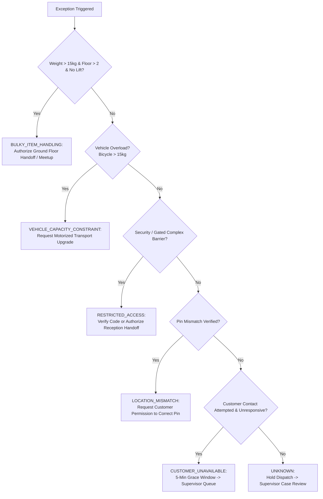

# MacroOps AI — Evidence-Based Doorstep Delivery Diagnosis Specification

**Document Version:** 1.0.0<br>
**Phase:** Phase 03 Part 02 — Last-Mile Exception Governance<br>
**Classification:** Operational Policy & Diagnostic Telemetry Architecture<br>
**System Invariant:** Preserves frozen Stage A/Stage B predictive models, canonical database views, and raw CSV files without modification.

---

## 1. Executive Summary & Purpose

In quick-commerce and dense urban logistics, last-mile delivery exceptions frequently occur near or at the customer's residence. Historically, automated dispatch systems have relied on coarse heuristics—such as GPS geofence pings or delivery confirmation button presses—to infer operational success or assign blame for failed deliveries.

This document formalizes an **evidence-based doorstep delivery diagnosis workflow** designed to:
1. **Differentiate ground truth from inference:** Separate sensor-observed facts, customer-supplied directions, courier-reported barriers, and model-generated hypotheses.
2. **Prevent unfair worker penalties:** Prohibit the attribution of courier fault or wage deductions based solely on GPS proximity readings or missing timestamps.
3. **Uphold ergonomic and physical safety:** Enforce strict carry-weight and vertical climb limits, ensuring couriers are never coerced into hazardous manual handling.
4. **Prevent false delivery confirmations:** Prohibit closing an order as successfully delivered without verified customer handover confirmation.
5. **Establish a standardized diagnostic schema:** Define concrete, structured telemetry fields for future mobile app and dispatch data collection without altering historical datasets.

---

## 2. Multi-Source Evidence Categorization Framework

To prevent automated conflation between what is empirically known and what is merely hypothesized, all delivery exception signals are partitioned into four strict epistemological tiers:

```
┌─────────────────────────────────────────────────────────────────────────────┐
│                    MULTI-SOURCE EVIDENCE TAXONOMY                           │
├─────────────────────────────────────────────────────────────────────────────┤
│  1. OBSERVED FACTS (Directly Measured by Hardware / Sensors)                │
│     - Scale-measured parcel weight (e.g., 22.5 kg).                         │
│     - Destination architecture: Floor number, presence/absence of elevator. │
│     - Hardware timestamp and GPS coordinate of courier device.              │
├─────────────────────────────────────────────────────────────────────────────┤
│  2. CUSTOMER-PROVIDED INFORMATION (Submitted via Customer App)              │
│     - Saved address line, flat/tower identifier, building landmark.          │
│     - Optional gate passcodes, entrance buzzers, or concierge notes.        │
│     - Explicit delivery preferences (e.g., "Leave at security desk").        │
├─────────────────────────────────────────────────────────────────────────────┤
│  3. WORKER-REPORTED INFORMATION (Submitted via Courier Partner App)         │
│     - Reported exception cause (e.g., "Gated society denied entry").        │
│     - Physical hazard reports (e.g., "Aggressive unleashed dog").           │
│     - Courier contact log (e.g., "Doorbell rang twice, phone unanswered").  │
├─────────────────────────────────────────────────────────────────────────────┤
│  4. MODEL-GENERATED HYPOTHESES (Machine Learning & Algorithmic Heuristics)   │
│     - Estimated SLA breach risk probability (Stage A / Stage B).            │
│     - Geofence dwell-time anomaly alerts (> 4 minutes stationary).          │
│     - Inferred pin discrepancy hypothesis (Unconfirmed suggestion only).    │
└─────────────────────────────────────────────────────────────────────────────┘
```

### Strict Diagnostic Governance Rules
- **Rule 1 (No Inferred Fault):** A model hypothesis or lack of telemetry (e.g., a missing GPS ping) must **never** be recorded as a confirmed courier fault.
- **Rule 2 (No Unverified Completion):** Absence of an exception report does not equal proof of customer handover. Delivery completion requires affirmative verification.
- **Rule 3 (Contradiction Flagging):** When courier-reported information directly contradicts customer-provided information (e.g., courier reports "Gate locked" while customer instructions say "Gate open 24/7"), the case must escalate to human support triage rather than defaulting to either party's claim.

---

## 3. Standardized Exception Reason Categories

Every doorstep delivery exception must resolve to one of six mutually exclusive, auditable reason categories:

| Reason Category | Operational Definition | Primary Supporting Evidence Required | Prohibited Inferences |
| :--- | :--- | :--- | :--- |
| **`LOCATION_MISMATCH`** | Physical drop-off location or building entrance does not correspond to the customer's saved map pin. | Delivery partner report of address variance + customer pin deviation > 150m. | Never infer intentional worker diversion from raw GPS drift in dense urban high-rises. |
| **`RESTRICTED_ACCESS`** | Gated society, high-security apartment complex, commercial office lobby, or boom barrier prohibits courier entry. | Delivery partner report + absence of security clearance code or visitor pass. | Never assume the worker refused to deliver if security denies entrance. |
| **`CUSTOMER_UNAVAILABLE`** | Delivery partner reached verified doorstep but customer is unreachable via doorbell, phone call, or chat. | Recorded arrival at doorstep + at least one documented outgoing contact attempt. | Never conclude customer unavailability without logged attempt to contact. |
| **`BULKY_ITEM_HANDLING`** | Order parcel weight or volumetric size exceeds solitary manual handling safety thresholds. | Parcel weight > 15.0 kg combined with destination floor > 2 and no working elevator. | Never demand or expect solitary staircase ascent exceeding 15.0 kg. |
| **`VEHICLE_CAPACITY_CONSTRAINT`** | Assigned courier vehicle (e.g., bicycle) lacks cargo volume or payload rating to transport order safely. | Parcel weight > 15.0 kg assigned to bicycle, or parcel dimensions exceeding carry bag. | Never penalize courier for rejecting dispatch assignment exceeding vehicle limits. |
| **`UNKNOWN`** | Telemetry is incomplete, contradictory, or unverified. | Missing logs, unconfirmed arrival, or conflicting reports. | Never default `UNKNOWN` to worker fault or customer fraud. Must escalate to supervisor. |

---

## 4. Proposed Telemetry Schema Extension (Future Data Architecture)

To transition from synthetic simulation to real-world operational monitoring, the following structured fields are proposed for the future last-mile telemetry schema (`delivery_exceptions`):

```sql
-- Proposed Schema Extension: delivery_exceptions (Analytical Architecture)
CREATE TABLE delivery_exceptions (
    delivery_attempt_id         TEXT PRIMARY KEY,       -- Unique identifier for the dispatch attempt
    order_id                    TEXT NOT NULL,          -- Foreign key referencing orders table
    recorded_at                 TEXT NOT NULL,          -- ISO-8601 UTC timestamp of exception event
    evidence_source             TEXT NOT NULL,          -- courier_app | customer_call | gps_telemetry | supervisor
    failure_reason              TEXT NOT NULL,          -- LOCATION_MISMATCH | RESTRICTED_ACCESS | CUSTOMER_UNAVAILABLE | BULKY_ITEM_HANDLING | VEHICLE_CAPACITY_CONSTRAINT | UNKNOWN
    location_pin_verified       INTEGER,                -- 1 = Verified Accurate, 0 = Verified Mismatch, NULL = Unverified
    access_instructions_available INTEGER NOT NULL,     -- 1 = Customer provided notes, 0 = Missing
    customer_contact_attempted  INTEGER NOT NULL,       -- 1 = Outgoing call/SMS attempted, 0 = No contact attempted
    society_access_restricted   INTEGER NOT NULL,       -- 1 = Security denied entry, 0 = Free access
    parcel_weight_kg            REAL NOT NULL,          -- Weight verified at dark-store scale
    parcel_dimensions           TEXT,                   -- JSON: {"length_cm": 40, "width_cm": 30, "height_cm": 25}
    vehicle_capacity_verified   INTEGER NOT NULL,       -- 1 = Matches vehicle cargo rating, 0 = Overload
    customer_handover_confirmed INTEGER NOT NULL,       -- 1 = Handover OTP/signature confirmed, 0 = Unconfirmed
    escalation_status           TEXT NOT NULL,          -- RESOLVED_AT_DOORSTEP | ESCALATED_TO_SUPERVISOR | RETURN_TO_ORIGIN
    worker_penalty_prohibited   INTEGER NOT NULL DEFAULT 1 -- Hard guarantee: 1 = Worker protected
);
```

> [!IMPORTANT]
> **Data Integrity Guarantee:** These fields represent proposed future telemetry specifications for mobile app development. They do **not** modify existing immutable raw CSV files (`orders.csv`, `delivery.csv`) or alter the frozen Stage A/B predictive model checkpoints.

---

## 5. Diagnostic Decision Logic & Safe Action Pathways

When a delivery exception is triggered, the diagnostic engine follows a deterministic, prioritized decision tree:



### Action Pathway Specifications

1. **`AUTHORIZE_GROUND_FLOOR_HANDOFF`**
   - *Trigger:* Parcel weight > 15.0 kg without working elevator above Floor 2.
   - *Courier Directive:* "Do not attempt unassisted manual carry. Dispatch has authorized ground-floor handoff."
   - *Customer Communication:* "Your order contains heavy items ({{parcel_weight_kg}} kg) and our delivery partner has arrived at your building. Please meet at the ground-floor foyer or concierge desk."
   - *Worker Protection:* Zero penalty; delivery partner SLA timer stops at building perimeter arrival.

2. **`CORRECT_LOCATION_PIN_WITH_PERMISSION`**
   - *Trigger:* Verified distance discrepancy between map pin and physical street address.
   - *Courier Directive:* "Hold at current coordinates. Customer location correction requested."
   - *Customer Communication:* "Our delivery partner is having trouble locating your address based on the current pin. Please confirm your exact building entrance on the map."
   - *Worker Protection:* Rating and tip eligibility fully preserved.

3. **`REQUEST_SUITABLE_TRANSPORT`**
   - *Trigger:* Mismatch between parcel dimensions/weight and courier vehicle capability at dispatch.
   - *Dispatcher Directive:* "Dispatch motorized cargo partner or split delivery across two riders."
   - *Worker Protection:* Courier assigned in error receives reporting stipend and is freed for next order.

4. **`ESCALATE_UNRESOLVED_ACCESS_ISSUE`**
   - *Trigger:* Society gate guards refuse entry and customer does not respond to calls.
   - *Dispatcher Directive:* "Support agent contacts building society management or authorizes order cancellation with full courier compensation."

---

## 6. Prohibited Operational Practices (Governance Invariants)

The MacroOps delivery governance engine strictly enforces four negative constraints:

1. **PROHIBITED:** Recommending or requiring solitary manual lifting of parcels exceeding 15.0 kg up staircases above Floor 2.
2. **PROHIBITED:** Assessing driver score deductions, algorithmic deprioritization, or financial penalties based solely on inferred location drift or unverified exception causes.
3. **PROHIBITED:** Closing an order as "Delivered Successfully" based solely on proximity within 50 meters without affirmative customer handover confirmation.
4. **PROHIBITED:** Modifying customer location pins or address records autonomously without explicit customer authorization.

---

## 7. Explanation Completeness & Audit Reporting

For every exception processed, the system generates an audit record containing:
- **`diagnosis_summary`:** Plain-language explanation of the event.
- **`evidence_breakdown`:** Explicit separation into observed facts, customer data, worker data, and hypotheses.
- **`missing_information`:** List of unconfirmed data points required before definitive closure.
- **`escalation_status`:** Real-time routing tag (e.g., `ERGONOMIC_SAFETY_ESCALATED`, `SUPERVISOR_TRIAGE`).
- **`worker_protection_status`:** Affirmation that worker ratings, tips, and completion pay remain intact.
